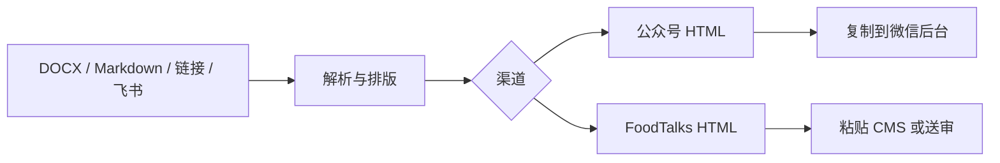
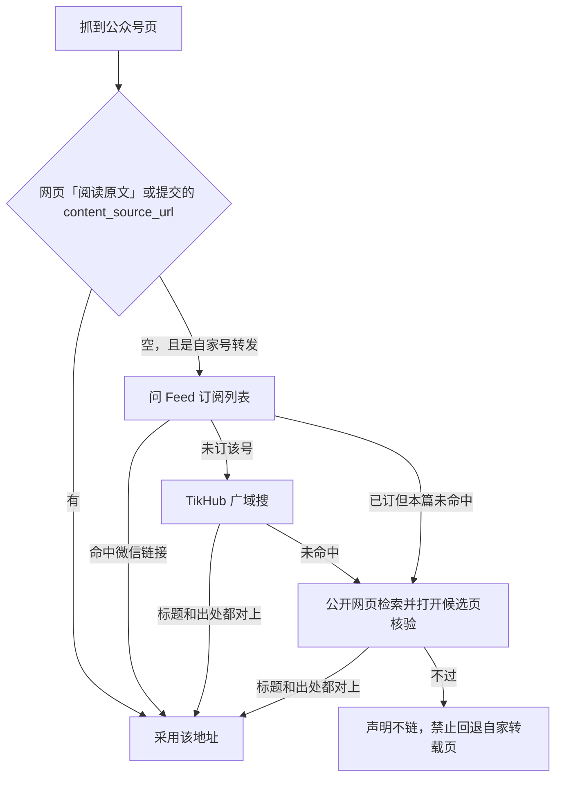

# FBIF 排版

[](#)
[](api/go.mod)
[](#)
[](https://github.com/garyzheng0714-lang/fbif-wechat-layout/actions/workflows/p0-monitoring-contract.yml)
[](#)

把 DOCX、Markdown、剪贴板正文或文章链接，转成能直接进微信公众号或 FoodTalks 的成品。

编辑只负责导入、核对、复制或送审。品牌规则、渠道兼容和发布风险由系统兜住。网站稿另走一条受控流水线：**隐藏草稿 → 飞书日聚合审核卡 → 人工公开**；管理后台也可打开「自动发布」。已公开的自有原创，再按需外发到固定平台。



---

## 这是什么

面向 FBIF 公众号编辑、FoodTalks 网站编辑和内容运营的内部工具。不是浏览器插件，也不是飞书多维表格插件。

内容链路拆成三个独立系统，只经 HTTP 通信，不共享存储：

| 系统 | 职责 |
| --- | --- |
| **本仓库** | 抓原文、排版、风险检查、飞书审核、分发 |
| `FoodTalks_Feed` | RSS / 供应商资讯的实时发现与筛选 |
| `fbif-wechat-article` | 微信已发稿的 T+1 归档与阅读指标 |

上游机器入口只交链接。`content_html` / `title` / `source_name` / `author` / `cover_url` 任一出现即 400。同稿按 `source_key` 只建一单。

---

## 现在能做什么

### 编辑器

- **一次一篇**：编辑器一次只处理一篇文章，没有多文件队列。飞书日聚合审核卡是发布侧把当天同通道的稿收进一张卡，不是编辑器批量排版。
- **粘贴即排版**：链接、正文、Markdown 同等对待；粘进导入框就按最终全文提交，追加粘贴整稿重排。没有「导入」按钮。手打用 `⌘/Ctrl + Enter`。`@` 搜索飞书文档不自动提交。
- **纯文本立刻出预览**：粘贴不含图片链的纯文本时，按正文块立刻渲染，不必等规则服务就绪；只排正文、不生成页脚。带图片链的剪贴板内容仍走 Markdown 文件路径。
- **多来源**：DOCX / Markdown / 剪贴板正文 / 公众号或网页链接 / 飞书云文档。旧 `.doc` 经 LibreOffice 或 CloudConvert 转 DOCX。
- **飞书云文档**：`@` 搜索或粘贴文档链接。服务端异步导出、剥图，再按图片张数并行转存图床（每张单独上传；同时转存的文档上限 2 份）。下载 / 拆图 / 缓存 / 转存上限 1GB。前端 long-poll 报真实阶段进度，离屏备齐后整帧上屏，导入期间旧稿仍可见。
- **复制立刻反馈**：点击复制即写入当前可粘贴 HTML。图片上传和「更多文章」在后台准备，不堵住按钮；复制层若还在等图，会提示「图片准备中」，完成后自动恢复。
- **预览与复制分层**：预览可用原图；复制层做 CSS 内联、微信兼容结构和已就绪的图片。公众号复制层遵守微信草稿 T0 存活（更多文章卡片图必须是微信图床或位图，禁 SVG data）。
- **单层账号菜单**：左栏导入卡第一行切换账号。同模板原地切，跨模板 / 跨渠道整页 reload。顶栏只放当前页面动作。
- **干净入口**：构建号只用于 JS / CSS 缓存，不写进地址栏。收藏夹留下 `/mp/fbif` 这类干净路径。
- **规则后台**：飞书登录 + 角色。右侧工作台只在打开时滑入一次，切分组或保存后不再整页重滑。账号目录在 `api/account_catalog.go`，跑 `npm run gen:registry` 生成前端注册表，禁止手改。

### 公众号成品

- 保留标题、正文、图片、超链接、列表、引用和参考来源。
- 图注连续：`图片 → 图注 → 图片来源` 不得拆进正文或文章级来源。
- URL 导入把来源 / 作者 / 编辑归一到正文末、`提示：` 页脚前，只渲染一次；正文有来源优先，否则用公众号名，不把 `byline` 补成作者。
- 原创 DOCX 从首个 `作者：` 行起读；标题、推荐语、校对仍剥掉。带「封面」结构标记的图和图注是选封面物料，按前置材料剥离，**不会接到正文开头**。没有「封面」标记时，作者行前的图同样剥离。
- 连续正文紧凑，只有原文空段才恢复段距。
- 作者为 `Mote莫特` / `Mote 莫特` 时，在参考来源上方插入固定署名图。
- 「更多文章」可选：规则可关；开了则用卡片自己的媒体库选封面，主稿图只兜底。

### 网站成品

- 独立渲染器，与公众号物理隔离。输出 inline-style HTML，给 FoodTalks CMS 粘贴。
- 图宽按 preset v19：横图默认 600；长图（高/宽 ≥ 1.7）固定 400；竖图按高 375 反推且宽不低于 300；自然宽不超过 300 的近正方小图按二维码 150。
- 表格按 CMS 存活双写：`border` / `cellpadding` / `align` / `bgcolor` / `width` 与表头 `<strong>`，清洗内联样式后不丢样。
- 转载：AI 优先判定出处，代码兜底抽「来源 / 出处 / 本文来自」；开头已有网站署名则删文末公众号口径来源 / 作者，否则降级 14px 灰斜体。
- 访谈：两个及以上「角色：」前缀各出现 ≥ 3 次时，提问方 FoodTalks 蓝 + 粗，回答方默认色 + 粗。
- 同文本 ≤16 字、无序号标题全篇出现 ≥ 2 次，判账号装饰行整段删除。
- 标题层级：`一、二、三` 和关键词短句是标题 1（h2）；`（一）` 与网站渠道的 `1、2、3` 走标题 2（h3）。
- 发布组装层：正文非空白 ≥ 3000 且 h2+h3 ≥ 5 时写确定性目录，**条目只收标题 1**。交互式渲染器仍关闭 `mctoc`。原创 / 转载一视同仁。
- 标签最多 3 个，只在 `tag_type_id=6` 里等值匹配，不自动建标；栏目 / 活动标签双侧拦截。公司库按标签词精确匹配，正文首次出现处插入 `mc-company-link`，每篇最多 3 家，失败只降级。
- 进 FoodTalks 和云梭的正文一律切除微信导流尾。
- **Mote 系列链**：作者是 Mote / 莫特的网站发布组装，会把正文里的 `mp.weixin.qq.com` 文章链换成已发布 FoodTalks `/news/{id}`。找不到或查询失败保留原链，不 fail。交互复制仍可保留公众号链。

### 转载原文补链

自家号转发别人的稿时，转载声明《标题》必须链到真正的原文，不能链回自家转载页。检索失败只降级，不让发布任务失败。本服务不再读取红狐。



顺序是固定的：

1. **网页优先**：抓取阶段读公众号 `msg_source_url`。机器入口可选带 `content_source_url` / `original_source_url`，只补出处，不替代抓取；网页抓到的阅读原文优先。
2. **Feed 订阅列表**：两边都空、且提交链接是自家转载页时，用 `PUBLISH_SYNC_SERVICE_TOKEN` 问 `FoodTalks_Feed` 的 `/api/internal/original-article`（标题 + 出处）。Feed 已返回可用微信链接就停。
3. **TikHub 广域搜**：Feed 还没订这个公众号时，才用 `TIKHUB_API_KEY` 调搜一搜（`/api/v1/wechat_search/v2/fetch_search`，`business_type=article`）。只按标题搜，**不按号拉历史列表、不搜公众号账号**。作者和标题都对上才用。
4. **网页检索兜底**：仍没有时再公开检索候选页，打开后核验标题和出处；核验不过就空着。
5. **记账与订阅**：查到原文只记账，不立刻让 Feed 订阅。同一公众号累计转发满 5 篇且已有微信链接，才向 Feed 申请订阅。

外号原文或自家原创仍用提交链接。密钥缺失或接口失败只降级。

### 发布与审核


- 机器入口 `site-sync` / `official-sync` 只收 `url`，只接受 `mp.weixin.qq.com`。可选 `content_source_url` 只补「阅读原文」，不替代抓取。
- AI 只预填封面、摘要、标签、作者和优化说明，**不改正文 HTML**。
- 同一北京日期、同一投递通道的稿聚成 **一张**「FoodTalks 内容审核」卡：封面、粗标题、标签、摘要、预览 / 原文、逐篇操作。标题已发布跳正式页，其余跳审核预览。
- **风险核查叠在全部文章下面**，默认折叠。只有显式 `confirmed` 的实质项或阻断级才进这栏；转载授权、待核、检查失败不当成内容告警打扰审核人。
- 公开必须持久 approve + 风险 `pass|warning` + 版本匹配，否则 fail closed。默认要人点卡片通过；管理后台「发布链路 → 自动发布」打开后，**新同步**且风险允许、没有同题已发布稿的任务，由系统身份 `system:auto_publish` 直接上线。已在待审核的稿不受影响。阻断级、同题已发布仍停待审核。群卡保留，已发布卡可下线。
- **卡片连点不怕飞书超时**：`card.action.trigger` 必须在 3 秒内回包，超时即飞书 108002。回调热路径只回 `{toast}`，不在窗口内读整库、不重建日批次卡。连点会先提示「已受理，正在处理」，审核 CAS 继续在后台做完，整张卡由后台原位更新。Webhook 与长连接共用这一套。
- 飞书群列表读不到时，只要审核群没改、仍是已保存的群，发布链路（含自动发布开关）仍能保存。改审核群时仍要能读到群列表。
- 运营在 CMS 手工公开后，流水线不覆盖正文，只把任务记为已发布并改卡。后台对账北京时间 8:30–18:00 每 2 分钟，其余每 30 分钟。
- 待审卡 best effort 标红同题已发布稿；首次 `stagePublicize` 落公开意图前再硬检，命中或查询失败都停。
- 外发只给已公开、审核版本有效、且判定为自有原创的稿。点「同步分发」时读网站**当前已公开稿**，不用任务库存里的旧正文。没有 `content_pk` 只人工对账，不盲重发。
- 失败单可结案（`abandon`）；短链过期可按任务号重排；切环境后的待审单须 `restage-current` 丢掉旧锚点，再在当前环境建隐藏草稿。

---

## 账号与入口

打开 `/` 会无条件跳到 `/mp/fbif`。没有渠道选择门户。

| 路径 | 页面 | 账号 |
| --- | --- | --- |
| `/mp/fbif` | `public/app.html` | FBIF食品饮料创新 |
| `/mp/wowfood` | 同上，复用 fbif 模板 | WowFood爆品超市 |
| `/mp/foodtalks-series` | 同上，独立系列模板 | FoodTalks什么是系列 |
| `/ft/ft-default` | `public/site.html` | 网站默认 |
| `/ft/ft-series` | 同上，复用网站渲染器 | 网站·什么是系列 |

`/app.html`、`/mp` 仍是公众号工具的过渡 alias。任意 `/ft/<id>` 回落 `ft-default`，不会掉进公众号包。

---

## 怎么用

### 排版一篇稿

1. 打开对应账号路径，或用左栏菜单切换。
2. 把 DOCX / Markdown / 链接 / 正文粘进导入框，或拖入文件。飞书文档可 `@` 搜索。
3. 看预览：标题、图注、署名、页脚、「更多文章」。按需裁图、换卡、开关底部区块。
4. 点复制。不要等后台传图。去微信或 FoodTalks 后台粘贴，做发布前最后检查。
5. 复制按钮不会自动打开后台；旁边会给出粘贴目标链接，由你点。

### 送审一篇网站稿

1. 上游或编辑提交公众号文章 URL。
2. 系统抓取、按网站规则渲染、转存图、做风险检查，写入 FoodTalks **隐藏草稿**，停在 `awaiting_review`。
3. 审核群收到当天聚合卡。默认逐篇看预览 / 原文，通过或驳回。打开自动发布时，符合条件的新稿会直接上线，群里仍发卡片，也可以从卡片下线。连点卡片按钮只会看到 toast，不会把飞书打成 108002。
4. 已公开的自有原创，卡上才出现外发；再确认一次，并记下操作人。

更细的字段、状态码和幂等见 [发布接入契约](docs/publish-intake-contract.md)。

---

## 本地运行

**只看界面**（不走抓取 / 上传 / 发布）：

```bash
cd public
python3 -m http.server 8080
```

打开 `http://localhost:8080/app.html`。

**完整后端**（文章抓取、图片代理、飞书导出、发布任务）：

```bash
cd api
go run . -port 9000
```

```bash
curl http://127.0.0.1:9000/api/health
```

编辑器入口：`http://127.0.0.1:9000/mp/fbif`、`http://127.0.0.1:9000/ft/ft-default`。

---

## 当前状态

核对至 **2026-08-27**（含 [#135](https://github.com/garyzheng0714-lang/fbif-wechat-layout/pull/135)）。以源码、测试和 `deploy/config/env-schema.json` 为准；生产实例指向须现场看 `/api/publish/readiness`，不要从旧会议记录或旧日志推断。

**已经落地**

- 账号目录单一真相源；启动时与 `registry.js` 逐字节对账。
- 粘贴纯文本立刻出预览，不必等规则服务。
- 飞书导入走异步作业，禁退回同步入口。图床按图片张数并行上传，下载 / 拆图 / 缓存 / 转存上限 1GB。
- DOCX「封面」区的图留给选封面，不接到正文开头；标题 / 推荐语 / 校对仍剥掉。
- 图宽 preset v19 与离线 fallback、fixture 同值。
- 网站目录只收标题 1；`1、2、3` 与 `（一）` 走标题 2。
- Mote 系列网站发布把公众号互推链换成已发布站内稿。
- 转载原文补链：阅读原文 → Feed 订阅列表 → TikHub 广域搜（不按号拉列表）→ 网页核验；红狐已停用。
- 规则后台只在打开时滑入一次。
- 日聚合审核卡；风险栏在文后，且只报已确认项。
- 审核卡连点：3 秒窗口只回 toast，不重建整张卡，避免飞书 108002；审核在锁释放后继续做完。
- 发布链路可开自动发布；群列表读不到时，未改群仍能保存开关。
- 网站出处 / 署名 / 访谈 / 标签 / 公司库按 2026-08-17 规范修订。
- 手工 CMS 公开优先；外发读网站最新已发布稿。
- 地址栏不带构建号。推 `main` 只构建并事务上线，考试留在 PR。

**还不能写成已完成**

- `site.html` 页脚仍是内联原生拖拽，没有复用 `mountBlockPanel` + Sortable（红线 22），网站交互未收口。
- 同题硬闸只覆盖首次 `stagePublicize`，`stageRepublish` 尚未接入。
- 已有预览时，全局 `⌘/Ctrl + Enter` 会先复制旧预览；在导入框里用会变成「复制旧稿 + 提交新稿」。
- 从未建立 `ReviewCardMsgIDs` 的旧任务，在单群场景仍可能沿用 legacy `ReviewCardMsgID`。
- `FEISHU_REVIEWER_OPEN_IDS` 的 env schema（必填非空）与运行时「空白名单 + 群成员模式」尚未收敛。
- 单篇超大批量图的生产耗时仍未做专项验收。
- 网站 URL 导入整条链路的 CMS 粘贴存活（表格 / 图题 / 小标题）还没有整批闭环证据。
- 微信历史已发稿总量仍未核验；任何单接口计数都不能叫「全量」。

这些问题要另做功能修复和真实验收，不能靠文档宣称完成。

---

## 技术栈

| 层 | 实现 |
| --- | --- |
| 前端 | 原生 HTML / CSS / JavaScript ES modules |
| 后端 | Go 1.26.6，标准库 `net/http` |
| 测试 | `node --test`、Playwright、Go test；JS / Go 覆盖率棘轮 |
| 门禁 | PR 跑 [P0 workflow](.github/workflows/p0-monitoring-contract.yml)（无 paths 过滤）：Go fmt/vet/staticcheck/race/govulncheck、JS 语法与 import cycle、npm audit、ShellCheck、env schema。浏览器只考 Chrome |
| 部署 | 推 `main` 只构建并事务切换，不再重考、不装浏览器 |

---

## 项目结构

```text
.
├── public/                 # 编辑器静态页与前端模块
│   ├── index.html          # 根路径，无条件跳到 /mp/fbif
│   ├── app.html            # 公众号工具  /mp/*
│   ├── site.html           # 网站工具    /ft/*
│   └── js/templates/       # 三套渲染器，互不 import
├── api/                    # Go API、规则、发布状态机、飞书
├── render-service/         # Node headless 渲染
├── deploy/                 # Caddy、systemd、env schema、事务脚本
├── tests/                  # 前端模块测试
├── docs/                   # 文档入口见 docs/INDEX.md
├── DESIGN.md               # 界面与预览视觉契约
└── CLAUDE.md               # 工程红线
```

更细的文件职责仍以源码注释为准，不在 README 展开。

---

## 快捷键

| 快捷键 | 操作 |
| --- | --- |
| `⌘/Ctrl + V` | 导入框粘贴后自动排版（`@` 飞书搜索除外） |
| `⌘/Ctrl + Enter` | 提交导入框。**已有预览时全局还会先复制旧预览** |
| `Esc` | 从预览返回上传页 |

---

## API

完整字段与状态码以源码和 [发布接入契约](docs/publish-intake-contract.md) 为准。机器调用发布提交 / 紧凑状态 / 监控用 `X-Publish-Sync-Token`（`PUBLISH_SYNC_SERVICE_TOKEN`）。管理接口用登录会话或 `PUBLISH_ADMIN_SERVICE_TOKEN`。

### 排版与导入

| 方法 | 路径 | 说明 |
| --- | --- | --- |
| `GET` | `/api/health` | 健康检查 |
| `POST` | `/api/fetch-article` | 抓取文章，返回结构化块或 Markdown |
| `POST` | `/api/fetch-article-meta` | 标题、封面、规范链接、正文媒体图（更多文章选图） |
| `GET` | `/api/image-proxy` | 图片代理 |
| `POST` | `/api/oss-upload` | 图片上传；未配上游时回原 base64 |
| `POST` | `/api/wechat-upload` | 上一项的旧名 |
| `POST` | `/api/doc-to-docx` | 旧 `.doc` 转 `.docx`（上传上限 50MB） |
| `GET` | `/api/doc-cache/{hash}/{filename}` | 转换过程缓存图 |
| `GET` | `/api/feishu/docs/search` | 飞书云文档搜索，需登录 |
| `POST` | `/api/feishu/docs/export/jobs` | 创建异步导出作业 |
| `GET` | `/api/feishu/docs/export/jobs/{job_id}` | long-poll 进度（`after` / `wait_ms`） |
| `GET` | `/api/feishu/docs/export/jobs/{job_id}/result` | 取回已镜像图片的 DOCX |
| `DELETE` | `/api/feishu/docs/export/jobs/{job_id}` | 取消作业 |
| `POST` | `/api/feishu/docs/export` | 同步导出兼容入口；**交互导入禁止使用** |
| `POST` | `/api/render` | 程序化渲染，Bearer `RENDER_TOKEN` |
| `POST` | `/api/html-to-blocks` | HTML → 中立 Block[]，只转换不建任务 |

### 登录与规则

| 方法 | 路径 | 说明 |
| --- | --- | --- |
| `GET` | `/auth/feishu/fbif/login` | 飞书 OAuth |
| `GET` | `/auth/feishu/fbif/callback` | OAuth 回调 |
| `POST` | `/auth/password/login` | 可选本地密码账号 |
| `POST` | `/auth/feishu/logout` | 登出 |
| `GET` | `/api/me` | 当前用户、角色、飞书能力 |
| `GET` | `/api/feishu/chats` | 当前用户所在群，供选审核群 |
| `GET` | `/api/rules/active?account=` | 账号当前规则；默认 fbif |
| `GET` | `/api/rules/presets` | 编辑器可用预设目录 |
| `POST` | `/api/rules/admin/login` | 已退役，固定 `410 Gone` |
| `GET` / `POST` / `DELETE` | `/api/rules/admin/presets` | 规则预设 CRUD，需管理员 + `base_revision` |
| `PUT` | `/api/rules/admin/active` | 绑定账号当前规则 |
| `GET` / `PUT` | `/api/rules/admin/access-users` | 超级管理员授权 |

### 发布接入与监控

| 方法 | 路径 | 说明 |
| --- | --- | --- |
| `POST` | `/api/publish/site-sync` | 实时线：只收链接 + 类型证据 |
| `POST` | `/api/publish/official-sync` | 归档线：同样只收链接；`ordinary_confirmed` 服务端钉死 |
| `POST` | `/api/publish/sync-status` | 紧凑任务状态，不含正文 |
| `GET` | `/api/publish/monitoring` | 跨系统监控摘要。processing / 通知未完成 / 卡缺失即 `ready=false` |
| `POST` | `/api/publish/monitor-alert` | 监控端告警转发到独立飞书私聊；本服务不主动外检 |
| `GET` | `/api/publish/readiness` | 部署只读验收 |
| `GET` / `PUT` | `/api/publish/delivery-settings` | 审核卡飞书应用、目标群与自动发布开关 |

### 任务运维

| 方法 | 路径 | 说明 |
| --- | --- | --- |
| `GET` | `/api/publish/jobs` | 任务摘要 |
| `GET` | `/api/publish/jobs/{id}` | 任务详情 |
| `POST` | `/api/publish/jobs/{id}/review` | HTTP 审核默认关闭 |
| `POST` | `/api/publish/jobs/{id}/retry` | 从失败阶段续跑 |
| `POST` | `/api/publish/jobs/{id}/unpublish` | 请求下线 |
| `POST` | `/api/publish/jobs/{id}/republish` | 请求重新公开 |
| `POST` | `/api/publish/jobs/{id}/reconcile` | 人工处理不确定外调结果 |
| `POST` | `/api/publish/jobs/{id}/rerender-latest` | 用已存块按最新规则重排，不回源 |
| `POST` | `/api/publish/jobs/{id}/restage-current` | 丢掉跨环境旧锚点，在当前环境新建隐藏草稿 |
| `POST` | `/api/publish/jobs/{id}/abandon` | 失败单结案，不再点亮 24 小时失败铃 |
| `POST` | `/api/publish/jobs/{id}/ack-cms-published` | 网站已手工公开：不覆盖正文，只记账并改卡 |
| `POST` | `/api/publish/jobs/{id}/card-refresh` | 按当前代码重出审核卡；`?resend=1` 发新卡 |
| `POST` | `/api/publish/jobs/{id}/risk-recheck` | 真正重跑风险检查 |
| `POST` | `/api/publish/jobs/{id}/notification-replay` | 只重放失败通知 |
| `POST` | `/api/publish/jobs/{id}/repair-wechat-trailer` | 已公开稿切微信导流尾，不重审 |
| `POST` | `/api/publish/repair-wechat-trailer` | 批量修复可安全覆盖的泄漏稿 |
| `POST` | `/api/publish/jobs/{id}/retry-external-distribution` | 确认旧云梭稿作废后再重建分发 |
| `POST` | `/api/publish/cms-resync` | 按北京日期补 `isLatest` / 来源 ID |
| `POST` | `/api/feishu/card-callback` | 仅 `FEISHU_CALLBACK_MODE=webhook`；3 秒内只回 toast |
| `GET` | `/preview/publish/{id}?t=` | HMAC 审核预览 |

---

## 配置

机器可读合同是 `deploy/config/env-schema.json`。部署会在改 live 路径前检查未知键、重复键、必填空值和 schema 版本；验证器只输出变量名。

生产缺 `RULE_SUPER_ADMIN_OPEN_IDS` 必须启动失败。`FOODTALKS_EXPECTED_TARGET` 必须是 `test` 或 `production`，并与 API / 前台 / 后台 URL 一致。JSON 任务库只允许单实例写入。

| 变量 | 说明 |
| --- | --- |
| `ENV` | 生产必须显式 `production` |
| `FBIF_CONFIG_SCHEMA_VERSION` | 必须为 `1` |
| `WECHAT_UPLOAD_ENDPOINT` | 图片上传上游；未设则网站 URL 转存失败 |
| `LIBREOFFICE_URL` / `LIBREOFFICE_TOKEN` | `.doc` 转换 |
| `CLOUDCONVERT_API_KEY` | LibreOffice 不可用时的 fallback |
| `PUBLISH_ADMIN_SERVICE_TOKEN` | 发布管理机器令牌，不下发浏览器 |
| `PUBLISH_SYNC_SERVICE_TOKEN` | 上游提交 / 状态 / 监控的窄权限令牌；查 Feed 原文也用它 |
| `FOODTALKS_FEED_BASE_URL` | 向 Feed 查转载原文；缺省 `https://feed.foodtalks.cn` |
| `TIKHUB_API_KEY` / `TIKHUB_API_BASE_URL` | 可选。Feed 未订该号时用 TikHub 广域搜补微信链接；国内默认 `https://api.tikhub.dev`。失败只降级 |
| `REDFOX_API_KEY` / `REDFOX_API_BASE_URL` | 旧红狐兼容键；本服务不再读取，只为旧 `publish.env` 过渡保留 |
| `RULE_SUPER_ADMIN_OPEN_IDS` | 超级管理员飞书 `open_id`，只放秘密配置 |
| `AUTH_SESSION_SECRET` / `AUTH_USERS_PATH` | 会话签名与账号存储 |
| `FEISHU_LOGIN_APP_ID` / `SECRET` / `REDIRECT_URI` | 网页飞书登录 |
| `FEISHU_APP_ID` / `SECRET` / `FEISHU_REVIEW_CHAT_ID` | 审核通知与长连 |
| `FEISHU_CALLBACK_MODE` | 必须 `websocket` 或 `webhook` |
| `FEISHU_REVIEWER_OPEN_IDS` | 审核白名单；schema 目前仍要求非空 |
| `FEISHU_REVIEWER_ALLOW_CHAT_MEMBERS` | 当前审核群成员可点卡 |
| `RULES_STORE_PATH` / `PUBLISH_JOBS_PATH` | 规则与任务 JSON |
| `RENDER_TOKEN` / `RENDER_SERVICE_URL` | 程序化排版 |
| `FOODTALKS_BASE_URL` / `TOKEN` / `FRONT_URL` / `ADMIN_ARTICLE_URL` | FoodTalks API 与入口 |
| `FOODTALKS_CATEGORY_IDS` | 原创分类，默认 `52,58` |
| `FOODTALKS_REPOST_CATEGORY_IDS` | 转载分类，默认 `53` |
| `FOODTALKS_EXPECTED_TARGET` | `test` 或 `production` |
| `DEPLOYMENT_WRITES_PAUSED` | 候选实例为 `1` 时暂停写入口与 worker |
| `ARK_API_KEY` / `ARK_MODEL_ID` | AI 预填与风险检查；失败降为 `warning`，不挡人审 |
| `SITE_OWN_ACCOUNTS` | 自有账号清单，用于原创 / 转载 |
| `YUNSUO_*` | 云梭外发；目标账号服务端固定 |
| `PUBLISH_MONITOR_FEISHU_USER_ID` | 监控告警私聊收件人 |
| `LAYOUT_MONITOR_URL` / `FEED_MONITOR_URL` / `OFFICIAL_MONITOR_URL` | 旧 watchdog 兼容键；本服务不读取、不探活 |

无密钥示例子 `deploy/config/`。不要把飞书、令牌、CloudConvert 或服务器密钥提交进仓库。

---

## 测试

```bash
npm test
```

```bash
cd api
go test ./...
```

浏览器：`npm run test:e2e`（CI 用 `test:e2e:ci`，只留缓存的 Chrome）。

---

## 部署

合并进 `main` 前，PR 必须过无路径过滤的 P0 workflow。推 `main` 只触发 [deploy.yml](.github/workflows/deploy.yml)：

1. 用 Go 1.26.6 构建 `api/fbif-api`，写入 `public/version.json`。
2. 把 public、API、renderer、Caddy、systemd、env schema 同步进隔离 release；候选 API 强制 `DEPLOYMENT_WRITES_PAUSED=1`。
3. 校验三类 env、单元和当前服务后，事务切换。
4. 核验公网 commit SHA、健康、鉴权和 `/api/publish/readiness`。
5. 写暂停窗口只清理已退役的本仓库 watchdog 与审核群监控播报，不恢复、不重建外检。
6. 验收后先关自动回滚，再解暂停。此后失败只向前修。
7. `finalize` 保留最多 5 份历史快照（不含密钥 env）。

规则后台：GitHub Secret 维护超级管理员 `open_id` → 本人登录后在「权限管理」把已登录账号升为管理员。网页不再使用共享密码。

---

## 文档

| 文档 | 内容 |
| --- | --- |
| [docs/INDEX.md](docs/INDEX.md) | 文档入口与阅读顺序 |
| [PRODUCT.md](PRODUCT.md) | 用户、产品目标和不可牺牲的体验 |
| [DESIGN.md](DESIGN.md) | 编辑器外壳与预览视觉契约 |
| [CLAUDE.md](CLAUDE.md) | 工程红线 |
| [发布接入契约](docs/publish-intake-contract.md) | 上游怎么把链接交进来 |
| [FoodTalks API 契约](docs/foodtalks-api-contract.md) | CMS 字段、分类、同题防重 |
| [编辑部规范](docs/editorial-norms-foodtalks.md) | 网站元数据口径 |

`docs/worklogs/` 和 `openspec/changes/` 是过程记录，不是当前规则的单一真相源。
